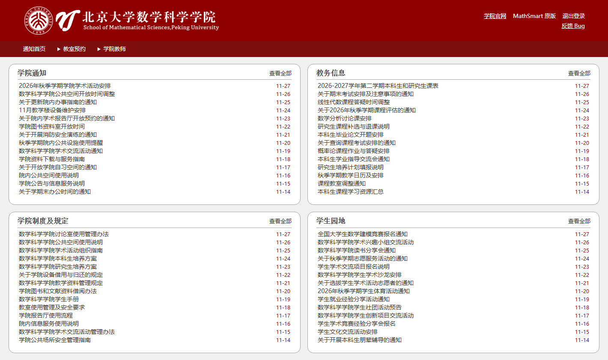
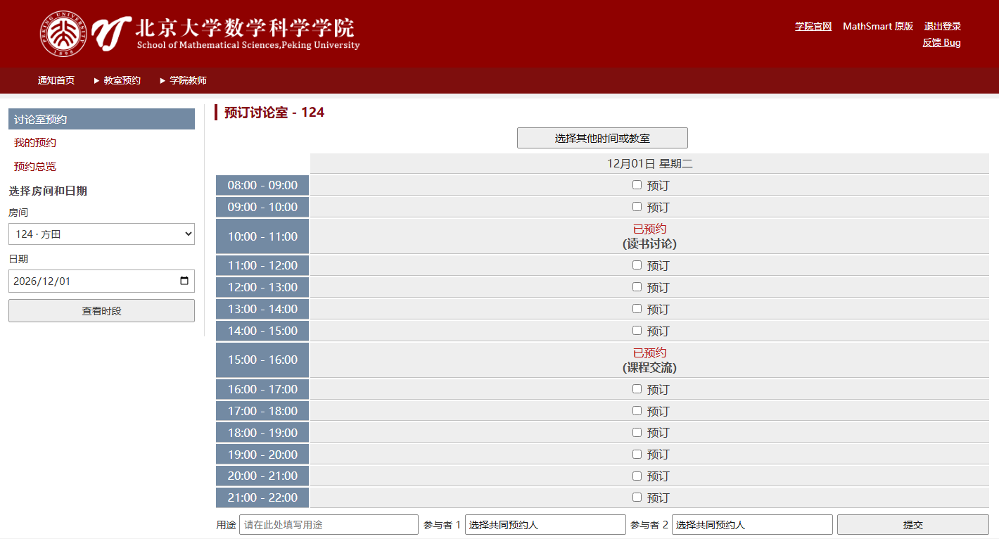

# MathIdiot · 数院旧主页复刻

为北京大学数学科学学院的院内门户提供旧版页面的复刻，安装后使用自己的账号登录MathSmart网站即可。扩展仅在 `mathsmart.pku.edu.cn` 上运行，无需服务器，不保存或上传通知，也不读取你输入的账号和密码。查询可预约房间时，只在 MathSmart 的同源请求中沿用登录会话。本插件不收集个人信息。

由于未保存旧页面快照，只能根据记忆进行复刻，如有同学愿意提供截图可以发送到issue页面。目前只复刻了我常会使用的部分功能，欢迎PR（若未及时回应可以微信联系：15001198883）。

## 安装

两种安装方式功能相同，任选一种即可。

### 方式一：Tampermonkey（篡改猴）

1. 安装 [Tampermonkey](https://www.tampermonkey.net/)。Chrome 若有「允许运行用户脚本」开关，在 Tampermonkey 的扩展详情中将其打开。旧版 Chrome 可参照 [Tampermonkey 官方说明](https://www.tampermonkey.net/faq.php#Q209)开启开发者模式。
2. 点击[安装 `math-portal.user.js`](https://github.com/nanomsj/mathidiot/releases/latest/download/math-portal.user.js)，在安装确认页点「安装」。
3. 如果浏览器直接下载了文件，打开 Tampermonkey 管理面板的「实用工具」，在「从文件导入」处选择下载的 `.user.js` 文件并确认安装。
4. 登录并刷新 [MathSmart](https://mathsmart.pku.edu.cn/schedule)。

Tampermonkey 会按自己的更新周期检查版本，自动更新可能有延迟。需要马上更新时，再打开上面的脚本链接安装最新版。

### 方式二：Chrome 扩展 ZIP

1. 下载并解压 [mathidiot-chrome.zip](https://github.com/nanomsj/mathidiot/releases/latest/download/mathidiot-chrome.zip)。也可以在仓库首页点击「Code → Download ZIP」，解压源码。
2. 在 Chrome 地址栏输入 `chrome://extensions/`，打开「开发者模式」。
3. 点击「加载未打包的扩展程序」，选择包含 `manifest.json` 的文件夹。
4. 登录并刷新 [MathSmart](https://mathsmart.pku.edu.cn/schedule)。

更新时，下载新版 ZIP 并将文件解压到原扩展文件夹，在扩展管理页点「重新加载」，再刷新 MathSmart。

## 功能

- 查看通知
- 预约学生讨论室相关功能：讨论室预约、我的预约、单日预约总览
- 查看教师名单和学院通讯录
- 点击右上角可切回新版主页，也可以切换回来。

## 更新日志

### v1.1

- 微调了排版，对于窗口宽度变化可以灵活适应。
- 「查看全部」页支持搜索新版通知标题，清空搜索后恢复原列表。
- 调整首页页眉和导航，使用深红底白字。桌面首页随窗口高度调整显示条数，窄屏改为单列。
- 将旧门户通知合并到对应栏目的新版通知之后，每栏最多纳入 50 条旧通知。修复旧通知的附件重复显示。
- 修复从链接直接打开讨论室预约时无法换房的问题。换房时保留所选日期，无可预约时段时隐藏表单。
- 统一「我的预约」表格配色。隐藏页面外侧滚动条，保留滚轮滚动及预约总览的横向滚动。
- 新增站内「学院通讯录」，风格参考讨论室预约页面。学院官网「教师队伍」在新标签页打开。
- 打开讣告切换为黑白。

### v1.0

- 初步实现查看通知、预约学生讨论室功能的复刻。
- 造成了若干bug

## 界面截图

### 四栏通知首页

### 讨论室预约

## 开发

直接修改 `portal.js` 和 `portal.css`，然后在 Chrome 重新加载扩展。运行 `node build-userscript.mjs` 可用同一份源码生成独立的 `math-portal.user.js`。MathSmart 更新页面结构时，通知选择器可能需要调整。

欢迎在 [GitHub Issues](https://github.com/nanomsj/mathidiot/issues) 反馈问题。

本项目使用 [MIT 许可证](LICENSE)。

页眉使用[学院英文官网提供的白色院徽与院名图](https://math-en.pku.edu.cn/images/logo.png)。

## 碎碎念

使用 chatgpt 6.2 Sol 高。由于本人对ai味浓厚的网页过敏而且不想每天打开页面看到一些无用的功能例如“综测”，因此用ai搓了一个自用的页面（我完全不会前端啊喂）。事实上只是自用，不过既然做了就在github上充个数好了（）我希望部署过程不是很难，如果难的话可以把这个仓库发给ai让ai帮你部署（小声）。

对了本人也没有追求完全一致，例如预约的日期选择之类的进行了创造性调整（bushi），做到看起来能接受就先这样好了w。

就如“音乐与数学”课程上王老师讲的那样，人类是惰性的。两年前的我还在吐槽：这个主页看起来好“简陋”；但当我今天得知旧主页已经永久迁移的时候，却发现我早已习惯了旧主页。但即便“惰性”是个贬义词，我想，我们并无刻意为难自己的必要。
